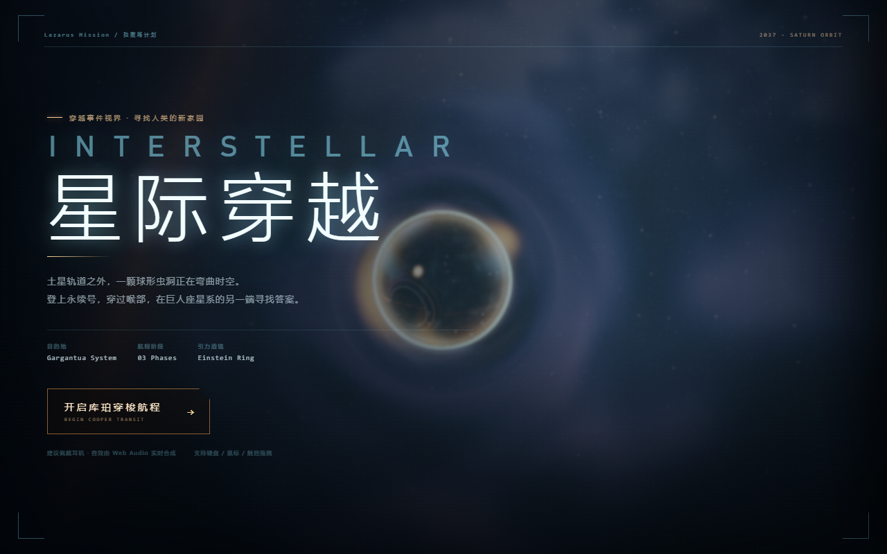
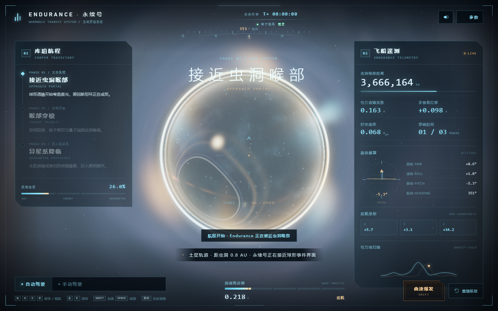
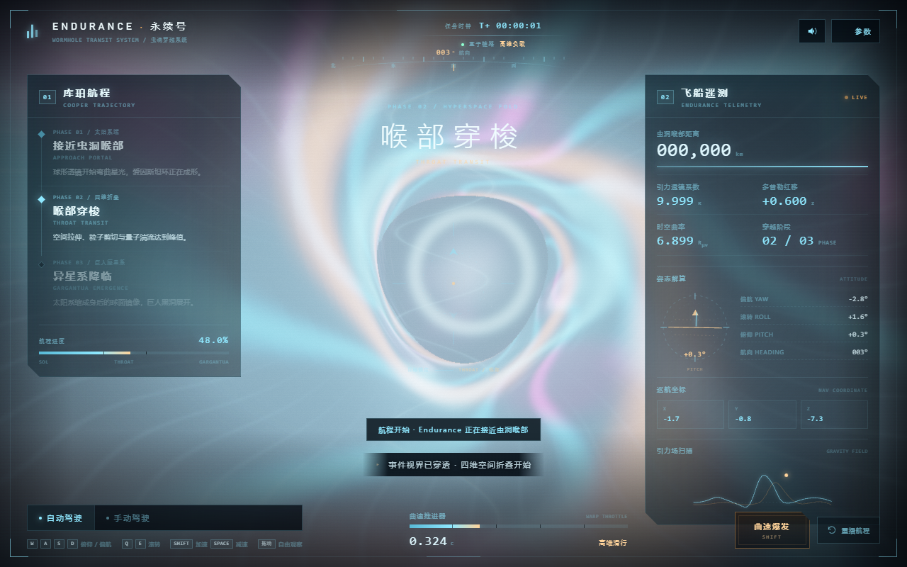
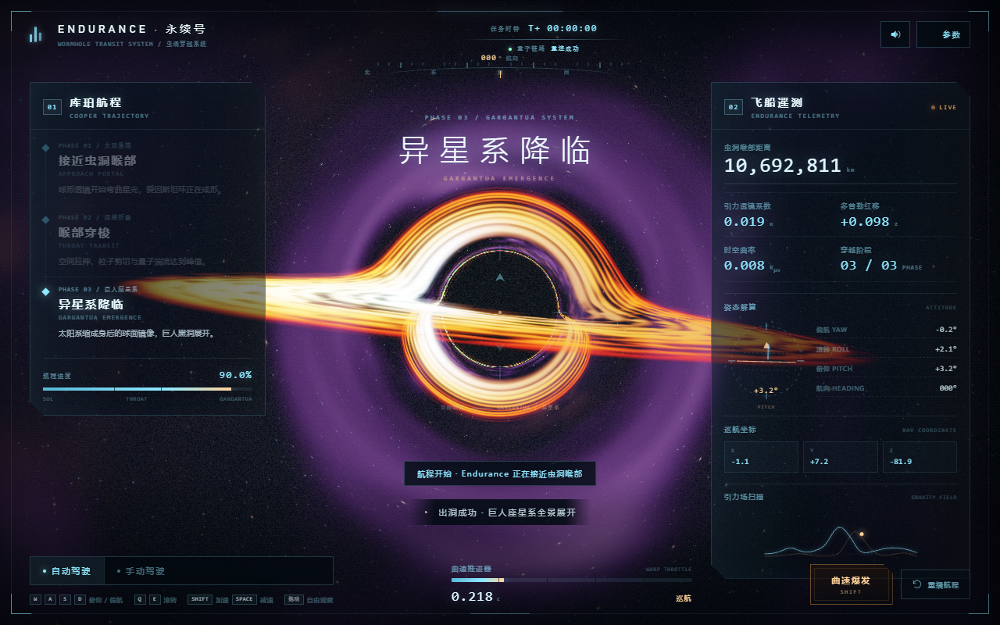
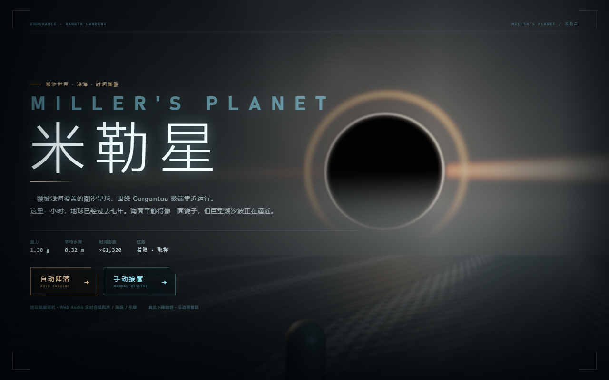
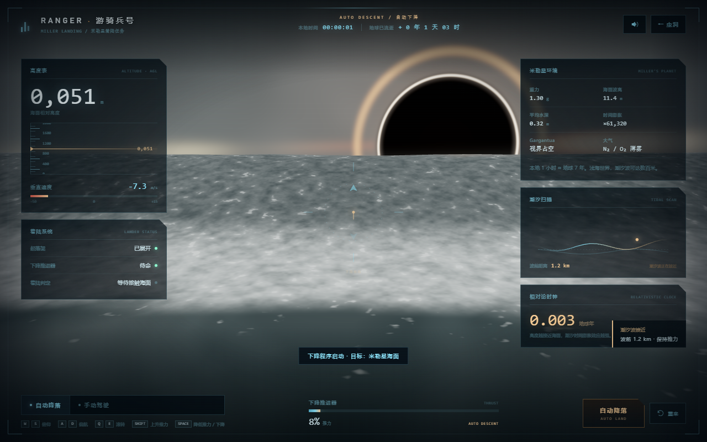
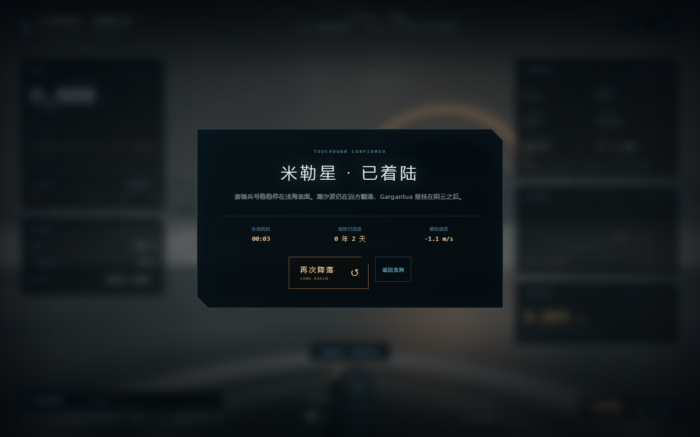
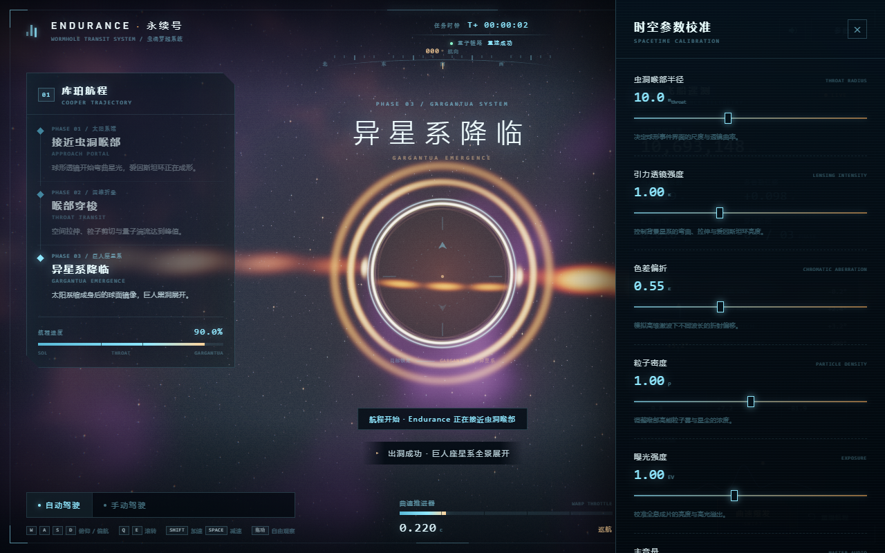
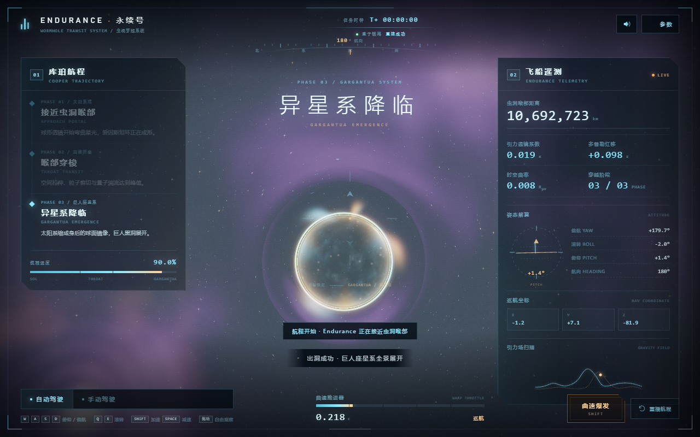
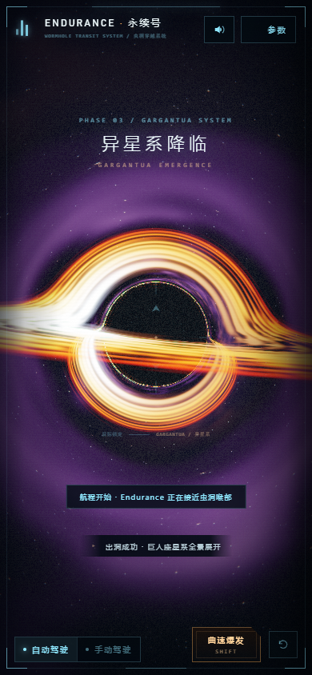

# 星际穿越 · 球形虫洞、Gargantua 与米勒星

基于 **Three.js + GLSL Raymarching** 的《星际穿越》沉浸式 WebGL 体验。

从太阳系端的球形虫洞出发，穿过四维折叠喉部，抵达巨人座星系，并见到 Gargantua 超大质量黑洞的吸积盘与光子环。全程配有全中文全息 HUD、实时引力透镜参数、Web Audio 原生合成宇宙音效，以及自动巡航 / 手动驾驶两种模式。

新增 **米勒星着陆任务**：驾驶游骑兵号穿越阴云、进入浅海潮汐世界，用真实下降物理（重力 / 推力 / 垂直速度 / 接触判定）手动或自动降落在海面上，而不是播放一段预烘焙的着陆动画。

> **在线演示**：部署到 GitHub Pages 后访问  
> <https://alex-jam-lab.github.io/Interstellar-Travel-Simulator/>
>
> **米勒星任务**：<https://alex-jam-lab.github.io/Interstellar-Travel-Simulator/miller.html>
>
> **GitHub 仓库**：<https://github.com/Alex-jam-lab/Interstellar-Travel-Simulator>



| 阶段一 · 接近虫洞 | 阶段二 · 喉部穿梭 | 阶段三 · 巨人座降临 |
| --- | --- | --- |
|  |  |  |

### 米勒星着陆任务

| 任务简报 | 下降进近 | 接触海面 |
| --- | --- | --- |
|  |  |  |

### 更多界面

| 参数校准面板 | 身后虫洞镜像 | 移动端 Gargantua |
| --- | --- | --- |
|  |  |  |

---

## 快速启动

```bash
npm install
npm run dev
# 打开 http://127.0.0.1:5173/
```

生产构建：

```bash
npm run build
npm run preview
# 打开 http://127.0.0.1:4173/
```

> 建议使用 Chrome / Edge 等支持 WebGL2 的现代浏览器，并佩戴耳机体验。
> 音频依赖浏览器用户手势策略，因此 Web Audio 会在点击「开启库珀穿梭航程」后启动。

---

## 页面打不开 / 加载失败？

本地预览依赖一个运行中的 Vite 进程。如果之前启动的服务器已经退出，浏览器会显示 `ERR_CONNECTION_REFUSED`，看起来就像“页面加载失败”，这通常不是代码或 Shader 的问题。

### 打开后卡顿 / 卡死？

如果页面能打开但动画非常卡，通常是高分辨率屏幕 + 核显同时承担了过重的全屏 Shader。当前版本已经默认：

- 限制开场渲染帧率为 10fps、航程中最高 45fps；
- 对 DPR 设置上限，自动模式内部按 0.75 缩放渲染；
- 只有阶段三靠近 Gargantua 时才执行黑洞光线积分；
- 根据帧时间自动继续降低分辨率。

仍卡顿时：

1. 进入参数面板，把 **渲染质量** 切到 **性能**；
2. 或在地址后加 `?quality=low`；
3. 确认浏览器开启了硬件加速，并在 Windows 图形设置里把 Edge/Chrome 指定为「高性能」（使用 RTX 独显）；
4. 关闭其他占用 GPU 的标签页或录屏软件。

三种可靠打开方式：

1. **离线单文件（最省事）**：直接双击  
   [`星际穿越-离线版.html`](星际穿越-离线版.html)  
   或 `dist/interstellar-standalone.html`。所有 JS/CSS 已内联，无需 Node、无需服务器，双击即可运行。
2. **一键预览**：双击 [`启动预览.cmd`](启动预览.cmd)，会自动安装依赖、构建并打开  
   `http://127.0.0.1:4173/`。
3. **手动命令**：
   ```bash
   npm install
   npm run build
   npm run preview
   ```
   若使用源码热更新，则运行 `npm run dev` 并打开 `http://127.0.0.1:5173/`。

重新生成离线单文件：

```bash
npm run standalone
```

会同时生成主航程与米勒星任务两个可双击文件：

```text
星际穿越-离线版.html
米勒星-离线版.html
```

---

## 部署到云端

这是一个**纯静态前端应用**：虫洞、黑洞、HUD 与音效全部在用户浏览器中运行。  
云端服务器只负责把 `dist/` 静态文件发给浏览器，**不需要 GPU、不需要 Node 后端、不需要数据库**。

构建命令固定为：

```bash
npm ci
npm run build
# 产物目录：dist/
```

`vite.config.js` 已设置 `base: './'`，因此部署在根域名或 GitHub Pages 子路径下都能正确加载资源。

### 方案一：Vercel（最快）

仓库已包含 `vercel.json`。在 Vercel 导入仓库即可，构建设置会自动识别为 Vite：

```text
Build Command: npm run build
Output Directory: dist
```

也可以使用 CLI：

```bash
npm i -g vercel
vercel --prod
```

### 方案二：Netlify

仓库已包含 `netlify.toml` 与 `public/_redirects`。连接 Git 仓库即可。

或直接拖拽 `dist/` 到 Netlify Drop，或：

```bash
npm i -g netlify-cli
npm run build
netlify deploy --prod --dir=dist
```

### 方案三：Cloudflare Pages

在 Cloudflare Pages 中连接仓库：

```text
Framework preset: None
Build command: npm run build
Build output directory: dist
```

也可以：

```bash
npm i -g wrangler
npm run build
wrangler pages deploy dist --project-name interstellar-wormhole
```

### 方案四：GitHub Pages

仓库已提供 `.github/workflows/deploy-pages.yml`。

1. 推送到 GitHub 的 `main` 分支；
2. 打开仓库 `Settings → Pages`；
3. 将 Source 设为 **GitHub Actions**；
4. 在 `Actions → Deploy static site to GitHub Pages` 中点击 **Re-run all jobs**；
5. 等待 Actions 完成，访问 `https://<username>.github.io/<repo>/`。

> 重要：必须先在仓库设置中启用 Pages，再运行部署工作流。`GITHUB_TOKEN` 没有权限直接创建 Pages 站点，因此工作流不能替你完成“启用 Pages”这一步。

`base: './'` 已经处理了子路径资源路径问题。

### 方案五：Docker + 任意云服务器

仓库包含多阶段 `Dockerfile`、`nginx.conf` 与 `docker-compose.yml`：

```bash
docker build -t interstellar-wormhole .
docker run -d --name interstellar -p 8080:80 interstellar-wormhole
# 浏览器访问 http://<服务器公网IP>:8080/
```

或者：

```bash
docker compose up -d --build
```

适用于阿里云 / 腾讯云 / AWS EC2 / Google Cloud VM / Azure VM 等。只需要开放 8080 端口，并把 Nginx 反向代理到 80/443 即可。

### 方案六：对象存储 / 静态网站托管

适合阿里云 OSS、腾讯云 COS、AWS S3、七牛等：

1. 执行 `npm run build`；
2. 将 `dist/` 内的全部文件上传到 Bucket；
3. 开启静态网站托管，入口文件设为 `index.html`；
4. 为 `.js` / `.css` 设置正确的 `Content-Type`；
5. 绑定自定义域名并开启 HTTPS。

也可以直接上传单文件 [`星际穿越-离线版.html`](星际穿越-离线版.html)，改名为 `index.html`，无需构建。它把所有 JS/CSS 都内联了，部署最省事。

### 云端运行注意事项

- **WebGL 在客户端执行**：云端不需要 GPU。真正吃显卡的是访问者浏览器。
- **HTTPS 推荐开启**：便于音频、全屏、剪贴板等浏览器能力正常工作。
- **音频需要用户手势**：点击「开启库珀穿梭航程」后 Web Audio 才会启动，这是浏览器策略。
- **MIME 类型**：确保 `.js` 为 `application/javascript`、`.css` 为 `text/css`、`.html` 为 `text/html`。
- **缓存**：带 hash 的 `assets/*` 可以长期缓存；`index.html` 建议短缓存。
- **Node 版本**：构建阶段建议 Node 22（Vite 8 需要现代 Node）。

---

## 体验动线

| 阶段 | 中文 | 画面内容 |
| --- | --- | --- |
| PHASE 01 | 接近虫洞喉部 | 太阳系深蓝 / 金色星云、银河带；球形虫洞的晶体折射与爱因斯坦环逐渐增强 |
| PHASE 02 | 喉部穿梭 | Raymarching 四维折叠管道、粒子剪切、量子闪烁、强色差与径向流速拉伸 |
| PHASE 03 | 异星系降临 | 巨人座星系紫青天球、Gargantua 黑洞阴影、光子环与相对论多普勒吸积盘 |

点击「开启库珀穿梭航程」后，镜头会沿预设电影级航线自动穿越。航程结束后仍保持自动巡航；也可以随时接管飞船。

---

## 米勒星着陆任务

从主页面顶部的「米勒星」入口或启动页的「米勒星着陆任务」进入：

```text
/miller.html
```

### 环境还原

- 被浅海覆盖的潮汐世界，平均水深约 0.32 m；
- 阴云密布的天空，远处悬挂着巨大的 Gargantua 黑洞与吸积盘；
- 巨型潮汐波从海平线推进，HUD 实时显示波前距离；
- 米勒星 1 小时 ≈ 地球 7 年，HUD 同步显示本地时间与地球流逝时间；
- 重力 1.30 g，海面反射、波峰白沫与溅落粒子全部程序化生成。

### 真实下降物理，而不是动画

游骑兵号的下降完全由状态更新驱动：

```text
重力 → 推进器推力 → 垂直速度 → 高度 → 海面接触判定
```

- 自动模式：自动控制律根据高度分段计算目标下降速度，调节推力并拉平姿态；
- 手动模式：直接控制上升 / 下降推力与姿态，自行寻找接地时机；
- 接触海面后根据垂直速度判定「软着陆」或「硬着陆」，并生成溅落水花与同心涟漪；
- 整段过程没有预烘焙的相机动画或着陆关键帧。

### 米勒星控制

| 按键 | 功能 |
| --- | --- |
| `W / S` 或 `↑ / ↓` | 俯仰 |
| `A / D` 或 `← / →` | 偏航 |
| `Q / E` | 滚转 |
| `Shift` | 增加上升推力 |
| `Space` | 降低推力 / 加速下降 |
| 鼠标拖拽 | 自由观察海面与 Gargantua |

底部可随时在「自动降落 / 手动驾驶」之间切换，右侧 HUD 显示高度、垂直速度、推力、潮汐扫描、相对论时钟与起落架状态。

离线体验：直接双击 [`米勒星-离线版.html`](米勒星-离线版.html)。

---

## 交互说明

### 模式
- **自动驾驶**：按 58 秒电影级航线自动推进，`Shift` 加速航程，`Space` 减速。
- **手动驾驶**：任意 WASD / 方向键会触发接管；鼠标拖拽始终用于自由观察。

### 键盘
| 按键 | 功能 |
| --- | --- |
| `W / S` 或 `↑ / ↓` | 俯仰（Pitch） |
| `A / D` 或 `← / →` | 偏航（Yaw） |
| `Q / E` | 滚转（Roll） |
| `Shift` | 曲速推进器过载 |
| `Space` | 减速 / 反推 |
| `P` | 打开 / 关闭参数面板 |
| `M` | 静音 / 恢复声音 |
| `Esc` | 关闭参数面板 |

### 鼠标 / 触控
- 在场景中按住并拖拽：自由观察 cockpit 视野之外的高维时空。
- 底部「曲速爆发」按钮支持按住触发。

### 参数面板
- **虫洞喉部半径**：改变球形事件界面的视觉尺度。
- **引力透镜强度**：控制星空弯曲、爱因斯坦环与切向弧强度。
- **色差偏折**：控制后期径向色差与高维激波下的颜色分离。
- **粒子密度**：控制喉部高能粒子雾与星尘。
- **曝光强度**：控制全息成片的亮度。
- **主音量**：控制 Web Audio 合成音效的总音量。
- **渲染质量**：性能 / 自动 / 高清。默认自动模式会把 DPR 与内部分辨率控制在安全范围；如果仍然卡顿，选择「性能」，或在 URL 后加 `?quality=low`。

---

## 核心特性

- **全屏 GLSL 逆向光线追踪**：解析法射线-球体求交 + 球内二次求交 + 双次折射，实现水晶球式虫洞。
- **引力透镜**：用冲击参数 `b` 近似弱场偏折角，配合屏幕空间爱因斯坦环、切向透镜弧与边缘暗带。
- **双星系天球**：太阳系端与 Gargantua 星系端使用完全程序化的星云、银河带、星场和背景星系。
- **Gargantua 黑洞**：世界坐标史瓦西近似光线积分、吸积盘平面求交、3D FBM 湍流、黑体色带、相对论多普勒射束、事件视界纯黑阴影与上下透镜弧。
- **Raymarching 喉部**：内壁 SDF、球体追踪、体积星尘、量子闪烁与出口光轮。
- **后期电影质感**：径向色差、六方向 Bloom、ACES Filmic、暗角、胶片颗粒与轻微扫描线。
- **Web Audio 原生合成**：零外部音频文件，包含低频深空轰鸣、时空剪切、推进器、量子撕裂与出洞清澈和声。
- **全中文全息 HUD**：阶段航线、距离、透镜系数、多普勒红移、曲率、姿态解算、巡航坐标、引力场扫描。
- **响应式与自适应**：桌面、平板、手机布局；开场低帧率预览、航程中 45fps 上限、自动降分辨率，避免高刷屏或核显把 GPU 拉满。

---

## 文件结构

```text
.
├─ index.html               # 主航程：页面结构、HUD、启动界面、参数面板
├─ miller.html              # 米勒星着陆任务页面
├─ 星际穿越-离线版.html      # 可直接双击打开的主航程单文件
├─ 米勒星-离线版.html        # 可直接双击打开的米勒星单文件
├─ 启动预览.cmd             # 一键安装/构建/启动本地预览
├─ 打开离线版.cmd           # 一键打开主航程离线文件
├─ Dockerfile               # 多阶段构建：Node 构建 + Nginx 运行
├─ docker-compose.yml       # 一键启动容器
├─ nginx.conf               # SPA 回退、缓存与 gzip 配置
├─ vercel.json              # Vercel 部署配置
├─ netlify.toml             # Netlify 部署配置
├─ public/
│  ├─ _redirects            # Netlify / Cloudflare Pages SPA 回退
│  └─ _headers              # 静态资源缓存头
├─ .github/workflows/
│  └─ deploy-pages.yml      # GitHub Pages 自动部署
├─ src/
│  ├─ main.js               # 主航程 Three.js 管线、相机航线、交互与 HUD
│  ├─ audio.js              # 主航程 Web Audio 原生合成引擎
│  ├─ style.css             # 全息 HUD 视觉系统与响应式布局
│  ├─ miller.js             # 米勒星海洋 / 天空 / 着陆物理 / HUD
│  ├─ miller.css            # 米勒星专用 HUD 与任务界面
│  └─ shaders/
│     ├─ scene.js           # 虫洞/透镜/双星系/黑洞/管道核心 Shader
│     └─ post.js            # Bloom、色差、ACES、颗粒与扫描线
├─ TECHNICAL.md             # 数学、物理与实现技术白皮书
├─ tools/                   # 构建、单文件打包、自动化测试脚本
└─ shots/                   # 展示截图
```

---

## 技术说明与边界

本项目追求的是**电影级视觉与实时交互**，不是数值广义相对论求解器：

- 引力透镜使用弱场偏折角的艺术化近似，并非逐点积分零测地线；
- 虫洞内部采用折射球模型与自定义 SDF 管道，而不是完整的 Morris–Thorne 度规测地线；
- 吸积盘的多普勒增亮、色偏与阴影半径做了风格化映射，单位经过归一化；
- 这些近似换来的是 WebGL 中稳定、可实时交互的帧率与可控的电影化画面。

更详细的公式推导、Shader 核心代码与性能调优方法见 [TECHNICAL.md](TECHNICAL.md)。

---

## 音效与视觉

所有音效由 Web Audio 节点实时合成，无任何外部音频文件。
所有星空、星云、星系、虫洞、黑洞与 HUD 均由代码生成，无外部贴图。

> 「我们曾经仰望星空，思考我们在宇宙中的位置；而现在我们只会低头，担心如何在这片土地上生存。」
>
> —— 《星际穿越》

---

本项目为非官方技术演示，与《星际穿越》电影版权方无关；所有星空、黑洞、虫洞与 HUD 均为程序化生成，未使用电影素材。

如果这个项目对你有启发，欢迎 Star ⭐

